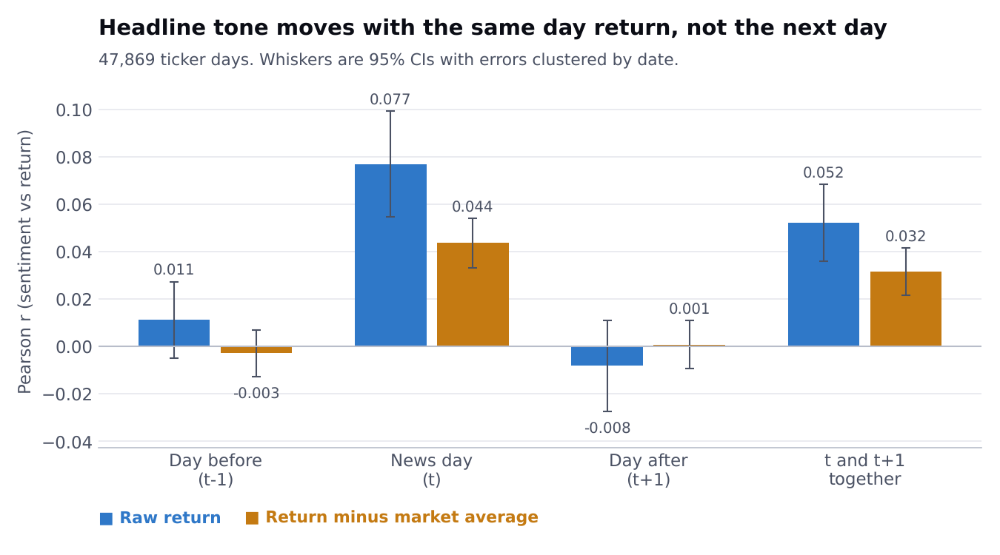
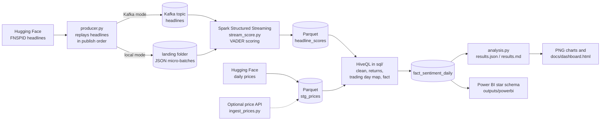
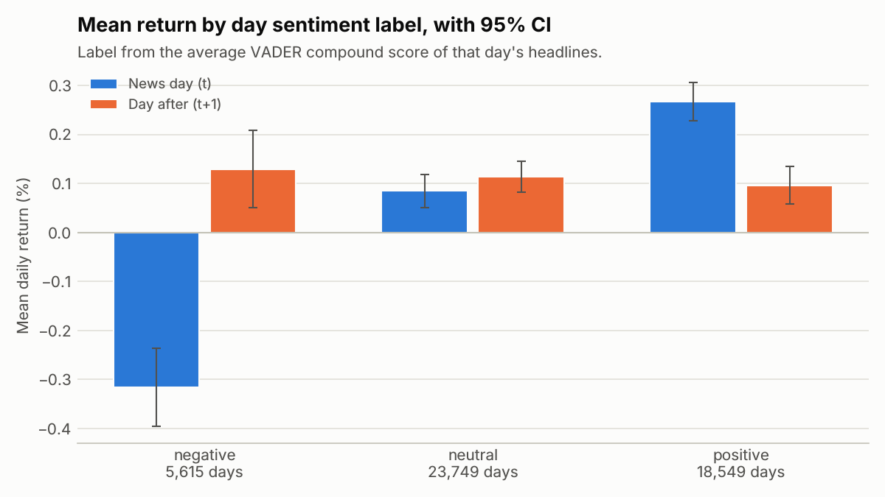
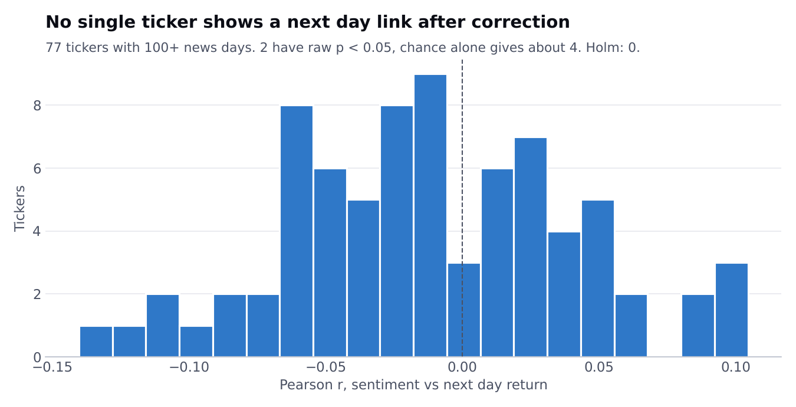
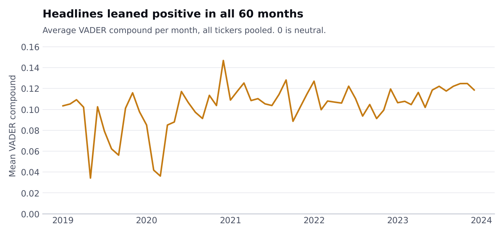

# Stock Sentiment Pipeline

Rebuilt in 2026 on public data. The original 2024 version was a team project at Conestoga College.

I wanted to answer one question. When news headlines about a stock are positive or negative, does the stock move the same way, on the same day or the day after?

This repo streams about 62,000 public NASDAQ-100 headlines through Kafka (or a local folder), scores each one with VADER in Spark Structured Streaming, cleans and joins them to daily prices with HiveQL, and checks the link with plain statistics. It also exports a star schema for Power BI and a small HTML dashboard.

Short answer: there is a small, clear link on the news day and no useful link on the day after. Details and caveats are below.



## Data

All data is public and downloads without an account.

| What | Dataset | Link | License |
|---|---|---|---|
| Headlines | `benstaf/FNSPID-nasdaq-100-post2019-1newsperrow`, a NASDAQ-100 subset of FNSPID with one headline per ticker per day, 2019 to 2023 | https://huggingface.co/datasets/benstaf/FNSPID-nasdaq-100-post2019-1newsperrow | No license on the subset page. The source, FNSPID (Dong, Fan and Peng, 2024, arXiv:2402.06698, https://huggingface.co/datasets/Zihan1004/FNSPID), is CC BY-NC 4.0 |
| Daily prices | `benstaf/nasdaq_2013_2023`, file `trade_data_2019_2023.csv` (84 NASDAQ-100 tickers, daily OHLCV, close is adjusted) | https://huggingface.co/datasets/benstaf/nasdaq_2013_2023 | No license on the page. Published with the paper arXiv:2502.07393. The prices originally come from Yahoo Finance |
| Optional price check | Yahoo Finance chart endpoint, keyless | `https://query1.finance.yahoo.com/v8/finance/chart/<ticker>` | Yahoo terms, personal and research use |

Because of the non commercial terms, this repo is for learning and portfolio use only. The raw files are not committed. `scripts/download_data.py` fetches them (about 235 MB), and `data/sample/` holds a small slice (8 tickers, 2023) so the pipeline and tests run without the download.

## Architecture



| Step | File | What it does |
|---|---|---|
| Replay | `pipeline/producer.py` | Sends headlines in publish order to Kafka, or writes them as JSON micro-batches to a landing folder |
| Score | `pipeline/stream_score.py`, `pipeline/sentiment.py` | Spark Structured Streaming reads Kafka or the folder, adds VADER compound, pos, neu and neg scores, writes Parquet |
| Clean and join | `sql/01` to `sql/05`, run by `pipeline/batch_sql.py` | HiveQL DDL for external tables, dedupe and trim, daily returns with window functions, map each headline to its trading day, build the daily fact table |
| Analyse | `pipeline/analysis.py` | Correlations with confidence intervals, label buckets, t tests, hit rate against a fair baseline, per year and per ticker checks |
| Present | `pipeline/charts.py`, `pipeline/dashboard.py`, `pipeline/export_powerbi.py` | PNG charts, a one page HTML dashboard, and the Power BI tables |
| Optional ingest | `pipeline/ingest_prices.py` | Pulls daily prices from a public API with retries and caching, then compares them with the static file |

The SQL runs in Spark with Hive support and a local Derby metastore, so the same files would run in Hive.

## How to run

You need Python 3.10 to 3.13 and Java 17. No Docker needed for the local mode.

```bash
make setup         # virtualenv + pinned packages
make run-sample    # whole pipeline on the committed sample, about a minute
make run-local     # downloads the data, then runs the whole pipeline, about a minute after the download
make test          # pytest
```

Without make:

```bash
python -m venv .venv && .venv/bin/pip install -r requirements.txt
.venv/bin/python scripts/download_data.py
.venv/bin/python -m pipeline.run --local
```

With Kafka:

```bash
docker compose up -d        # single node Kafka on localhost:9092
make run-kafka              # same pipeline, headlines go through the Kafka topic
docker compose down -v
```

Spark pulls the Kafka connector (`spark-sql-kafka-0-10_2.13:4.0.1`) from Maven Central on the first Kafka run. Both modes stop when the stream is drained (`trigger(availableNow=True)`). Remove that trigger in `stream_score.py` for an always on job.

The full run uses the topic `headlines` and the sample run uses `headlines_sample`. Spark reads each topic from the earliest offset, so a second run reads old messages again. The dedupe step in `sql/02_clean_headlines.sql` removes those repeats, so the results stay the same.

I tested the Kafka mode against a plain Kafka 3.9.0 broker started from the Apache tarball, because the machine I built this on had no Docker daemon. The results matched the local mode exactly. The `docker-compose.yml` uses the same Kafka version and settings, but I have not run it.

### Optional: prices from a public API

```bash
make prices-api                                  # fetch, cache, and compare with the static file
.venv/bin/python -m pipeline.run --local --prices api
```

`pipeline/ingest_prices.py` calls the keyless Yahoo Finance chart endpoint once per ticker. It retries with exponential backoff on HTTP 429 and 5xx, caches each response in `data/cache/prices_api/`, and falls back to the static file for any ticker that still fails, so the output is always complete. No API key is needed or stored.

When I ran it, 80 of 84 tickers came back from the API. ANSS, EA, WBA and WBD failed (delisted or renamed) and used the static rows. On the 100,480 matched ticker days, the API daily returns had a correlation of 0.9999 with the static file, and 0.9997 of them were within 1 basis point (`outputs/price_check.json`). So the static file is a faithful copy and the main results use it, which keeps runs reproducible.

## Method

- **Sentiment.** VADER compound score per headline, from -1 to 1. A headline is positive at 0.05 or above, negative at -0.05 or below, neutral in between. VADER is a lexicon model. It runs on CPU in seconds and needs no API. I did not use FinBERT, to keep the run fast and simple.
- **Trading day.** 0.9944 of the raw timestamps are exactly midnight, so the data has dates, not times. Each headline goes to the first trading day on or after its date. A Saturday headline counts for Monday.
- **Daily fact.** One row per ticker per trading day with at least one headline. The day's sentiment is the average compound score.
- **Returns.** Simple close to close returns on adjusted closes. `ret_prev` is the day before the news day, `ret_same` the news day, `ret_next` the day after. The `abn_` versions subtract the equal weighted average return of all tickers that day, which removes most market wide moves.

## Results

Every number here comes from `outputs/results.md` and `outputs/results.json`, written by `python -m pipeline.analysis` on the full data.

**Sample.** 61,827 headlines scored. 47,913 ticker days with news and prices, covering 79 tickers and 54,452 headlines, from 2019-01-02 to 2023-12-28. Headline labels: 32,066 neutral, 22,779 positive, 6,970 negative. Headlines lean positive.

**Correlation of daily sentiment with returns (Pearson r, 95% CI):**

| Window | n | Raw return | Return minus market |
|---|---|---|---|
| Day before (t-1) | 47,821 | 0.0051 [-0.0039, 0.0141] | -0.0049 [-0.0138, 0.0041] |
| News day (t) | 47,869 | 0.0773 [0.0683, 0.0862] | 0.0451 [0.0362, 0.0541] |
| Day after (t+1) | 47,912 | -0.0104 [-0.0193, -0.0014] | 0.0003 [-0.0087, 0.0093] |

Spearman gives the same picture: 0.0612 on the news day, -0.0063 on the day after.



**Mean return by day label:**

| Day label | Days | News day | Day after |
|---|---|---|---|
| negative | 5,615 | -0.316% | 0.129% |
| neutral | 23,749 | 0.085% | 0.114% |
| positive | 18,549 | 0.267% | 0.096% |

On the news day, positive days beat negative days by 0.583 percentage points (Welch t = 12.96, p < 0.0001). On the day after the gap is -0.033 points (t = -0.74, p = 0.4620), so nothing.

**Direction hit rate.** On non neutral days, the sign of sentiment matched the sign of the next day return 0.5121 of the time (24,098 days). That beats a coin flip on paper (p = 0.0002), but it is the wrong yardstick. Positive days are much more common than negative days, and stocks rose more often than they fell in this period. If sentiment and returns were unrelated, the expected hit rate would be 0.5126. The real hit rate is no better. On the news day the hit rate is 0.5404 against a baseline of 0.5193.

**By year.** The news day link is strongest in 2019 (r = 0.0993) and 2020 (0.1561) and much weaker from 2021 to 2023 (0.0242, 0.0272, 0.0200). The day after r stays between -0.0184 and -0.0003 in every year.

**Per ticker.** For the 77 tickers with at least 100 news days, the median r with the next day return is -0.0220. 4 of 77 have p below 0.05, which is about what chance alone would give.



**Headlines that describe a move.** 0.1155 of headlines contain words like soar, jump, fall, up or down. Dropping every ticker day with such a headline leaves 41,884 days, and the news day r is still 0.0714 [0.0619, 0.0809]. So the news day link is not only explicit "stock jumps" headlines.



### What I take from this

- Headline tone and price move together on the same day. The effect is small. A correlation of 0.0773 means sentiment explains well under 1% of the variation in daily returns.
- Headline tone does not help predict the next day. Once the market wide move is removed, the next day correlation is 0.0003.
- The same day link is not evidence that news moves prices. Without publish times I can't tell if a headline came before or after the move, and a lot of financial news is written about moves that already happened.

## Limitations

- **No time of day.** Almost all timestamps are midnight, so "news day" mixes pre market, intraday and after close news. This is the biggest weakness for any timing claim.
- **One headline per ticker per day.** The subset I used keeps one headline per ticker per day (weekend headlines roll into Monday, so a few days have two or three). The multi headline NASDAQ-100 version of FNSPID is about 825 MB to download, so I kept the smaller one.
- **VADER is not a finance model.** It reads "beat estimates" or "downgrade" poorly, and about half of the headlines score neutral. FinBERT would likely do better on tone, though I don't expect it to change the next day result.
- **Pooled p-values are optimistic.** Rows on the same date are not independent. The confidence intervals above treat them as if they were. The market adjusted numbers and the per year table are rough checks on that.
- **Survivorship.** The ticker list is NASDAQ-100 members from the dataset, so it leans toward large, successful companies.
- **Not a trading strategy.** No costs, no out of sample test, and the next day effect is zero anyway.

## Power BI

I can't build a .pbix on Linux, so `outputs/powerbi/` has the star schema (`fact_sentiment_daily`, `dim_ticker`, `dim_date`) as Parquet and CSV, plus `measures.dax`. `docs/powerbi.md` explains how to load it and lay out a report.

## Dashboard

`docs/dashboard.html` is a single self contained page (inline SVG, no external scripts) with the main numbers and charts. Open it in a browser or drop it into a static site. It is rebuilt on every run.

## Mapping to GCP

The 2024 version ran on GCP. This rebuild runs on a laptop, but it maps over with config changes, not code changes:

| Local | GCP |
|---|---|
| `data/raw`, `data/work/warehouse` | Cloud Storage buckets (`gs://.../raw`, `gs://.../warehouse`) |
| Local Spark | Dataproc cluster or Dataproc Serverless, submitting `pipeline/stream_score.py` and `pipeline/batch_sql.py` |
| Derby metastore | Dataproc Metastore (Hive compatible), so the `sql/` DDL runs unchanged |
| Kafka in Docker | Kafka on GCE or Managed Service for Apache Kafka. Pub/Sub would need a different Spark source |
| `fact_sentiment_daily` Parquet | A BigQuery external table on the GCS Parquet, or a load job into a native table |
| Power BI on CSV | Power BI reading BigQuery through its connector |

I did not run any of this on GCP for the rebuild.

## Repo layout

```
pipeline/        Python steps (producer, streaming job, SQL runner, analysis, charts, exports)
sql/             HiveQL files, run in order
scripts/         download_data.py
data/sample/     small sample, committed
tests/           pytest, including the SQL on a tiny hand made dataset
outputs/         results.md, results.json, monthly.csv, price_check.json, powerbi/
docs/            charts, dashboard.html, powerbi.md
```

## License

Code is MIT, see `LICENSE`. The datasets keep their own terms, listed above.
