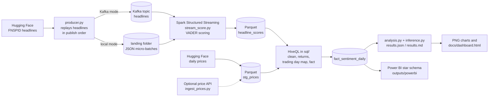
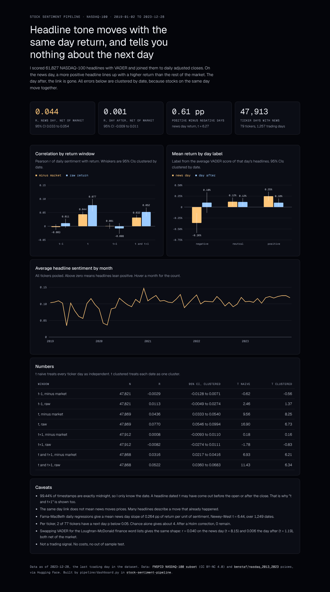

# Stock Sentiment Pipeline

Rebuilt in 2026 on public data. The original 2024 version was a team project at Conestoga College.

I wanted to answer one question. When news headlines about a stock turn positive or negative, does the stock move the same way, on the same day or the day after?

This repo streams about 62,000 public NASDAQ-100 headlines through Kafka (or a local folder), scores each one with VADER in Spark Structured Streaming, cleans and joins them to daily prices with HiveQL, and tests the link with statistics that allow for the fact that stocks on the same date move together. It also exports a star schema for Power BI and a one page HTML dashboard.

Short answer: on the news day, a more positive headline goes with a higher return than the rest of the market (r = 0.044, date clustered t = 8.25). On the day after there is nothing (r = 0.001, t = 0.16). Because the data has dates but no times, I can't say the news came first.


## Data

All data is public. The code in this repo is MIT. The data is not, and it keeps its own terms:

| What | Source | License |
|---|---|---|
| Headlines | [`benstaf/FNSPID-nasdaq-100-post2019-1newsperrow`](https://huggingface.co/datasets/benstaf/FNSPID-nasdaq-100-post2019-1newsperrow), a NASDAQ-100 subset of FNSPID with one headline per ticker per day, 2019 to 2023 | The subset page has no license. The source, [FNSPID](https://huggingface.co/datasets/Zihan1004/FNSPID) (Dong, Fan and Peng, 2024, arXiv:2402.06698), is **CC BY-NC 4.0**, so non commercial use only, with attribution |
| Daily prices | [`benstaf/nasdaq_2013_2023`](https://huggingface.co/datasets/benstaf/nasdaq_2013_2023), file `trade_data_2019_2023.csv` (84 tickers, daily OHLCV, adjusted close) | No license on the page. Published with arXiv:2502.07393. The prices come from Yahoo Finance |
| Finance word lists (optional) | [Loughran-McDonald Master Dictionary](https://sraf.nd.edu/loughranmcdonald-master-dictionary/), 1993 to 2025 version | Free for academic research. Commercial use needs a license from the authors |
| Price check (optional) | Yahoo Finance chart endpoint, keyless | Yahoo terms |

What is committed and what is not:

- The raw files are not committed. `make data` downloads them into `data/raw/` (about 235 MB from Hugging Face plus 9 MB for the LM dictionary). On my machine that took under 10 seconds, but it depends on your connection.
- `data/sample/` holds a small slice of the headlines and prices (8 tickers, 2023 only, 2,677 headlines) so the pipeline and tests run without any download. Those headlines are from FNSPID and stay under CC BY-NC 4.0.
- `data/checks/finance_phrases.csv` is 30 short phrases I wrote and labelled myself for a smell test of the two lexicons.
- `outputs/` holds numbers and the Power BI tables I built. The fact table has scores and returns but no headline text.

So this repo is for learning and portfolio use, not for anything commercial.

## Architecture



| Step | File | What it does |
|---|---|---|
| Replay | `pipeline/producer.py` | Sends headlines in publish order to Kafka, or writes them as JSON micro-batches to a landing folder |
| Score | `pipeline/stream_score.py`, `pipeline/sentiment.py` | Spark Structured Streaming reads Kafka or the folder, adds VADER compound, pos, neu and neg, writes Parquet |
| Clean and join | `sql/01` to `sql/05`, run by `pipeline/batch_sql.py` | External table DDL, dedupe and trim, daily returns with window functions, headline to trading day mapping, the daily fact table |
| Analyse | `pipeline/analysis.py`, `pipeline/inference.py`, `pipeline/lexicon.py` | Date clustered regressions, Fama-MacBeth, label buckets, hit rate against a fair baseline, per year and per ticker checks with multiple testing correction, a Loughran-McDonald comparison |
| Present | `pipeline/charts.py`, `pipeline/dashboard.py`, `pipeline/export_powerbi.py` | PNG charts, the HTML dashboard, the Power BI tables |
| Optional ingest | `pipeline/ingest_prices.py` | Pulls daily prices from a public API with retries and caching, then compares them with the static file |

The SQL runs in Spark with Hive support and a local Derby metastore, so the same files would run in Hive.

## How to run

You need Python 3.10 to 3.13 and Java 17. No Docker needed for the local mode.

```bash
make setup         # virtualenv + pinned packages
make run-sample    # whole pipeline on the committed sample, no download, about a minute
make run-local     # downloads the data, then runs the whole pipeline, about a minute after the download
make test          # pytest, including the real SQL files on a tiny hand made dataset
make lint          # ruff
```

The sample run writes to `outputs/sample/`, `docs/img/sample/` and `docs/dashboard_sample.html`, which are git ignored, so it never overwrites the committed full results. The sample is too small to say anything (8 tickers, so Fama-MacBeth is skipped), it is only there to prove the pipeline runs.

Without make:

```bash
python -m venv .venv && .venv/bin/pip install -r requirements.txt
.venv/bin/python scripts/download_data.py
.venv/bin/python -m pipeline.run --local
```

With Kafka:

```bash
docker compose up -d        # single node Kafka on localhost:9092
make run-kafka              # same pipeline, headlines go through the Kafka topic
docker compose down -v
```

Spark pulls the Kafka connector (`spark-sql-kafka-0-10_2.13:4.0.1`) from Maven Central on the first Kafka run. Both modes stop when the stream is drained (`trigger(availableNow=True)`). Remove that trigger in `stream_score.py` for an always on job.

The full run uses the topic `headlines` and the sample run uses `headlines_sample`. Spark reads each topic from the earliest offset, so a second run reads old messages again. The dedupe step in `sql/02_clean_headlines.sql` removes those repeats, so the results stay the same.

I tested the Kafka mode against a plain Kafka 3.9.0 broker started from the Apache tarball, because the machine I built this on had no Docker daemon. The results matched the local mode exactly. The `docker-compose.yml` uses the same Kafka version and settings, but I have not run it.

CI (`.github/workflows/ci.yml`) runs ruff and pytest on every push and pull request. It only uses the committed files, so it needs no network beyond installing packages.

### Optional: prices from a public API

```bash
make prices-api                                  # fetch, cache, and compare with the static file
.venv/bin/python -m pipeline.run --local --prices api
```

`pipeline/ingest_prices.py` calls the keyless Yahoo Finance chart endpoint once per ticker. It retries with exponential backoff on HTTP 429 and 5xx, caches each response in `data/cache/prices_api/`, and falls back to the static file for any ticker that still fails.

When I ran it, 80 of 84 tickers came back from the API. ANSS, EA, WBA and WBD failed (delisted or renamed) and used the static rows. On the 100,480 matched ticker days, the API daily returns had a correlation of 0.9999 with the static file, and 0.9997 of them were within 1 basis point (`outputs/price_check.json`). So the static file is a faithful copy, and the main results use it so runs are reproducible.

## Method

**Sentiment.** VADER compound score per headline, from -1 to 1. A headline is positive at 0.05 or above, negative at -0.05 or below, neutral in between. VADER is a lexicon model built for social media. It runs on CPU in seconds and needs no API. I made one change to it: VADER scores "share" and "shares" as positive (+1.2), so "Tesla shares fall after delivery numbers" came out positive. In headlines that word is a noun, and 4.4% of headlines contain "shares", so I removed both entries.

**Trading day.** 99.44% of the raw timestamps are exactly midnight, so the data has dates, not times. Each headline goes to the first trading day on or after its date, so a Saturday headline counts for Monday. This matters a lot for how to read the results. A headline dated t could have come out before the open (and moved the price on t), during the day, or after the close (and moved the price on t+1). I can't tell which. That is why I also test t and t+1 together as one two day window.

**Daily fact.** One row per ticker per trading day with at least one headline. The day's sentiment is the average compound score.

**Returns.** Simple close to close returns on adjusted closes. `ret_prev` is the day before the news day, `ret_same` the news day, `ret_next` the day after, `ret_2d` is close(t-1) to close(t+1). The `abn_` versions subtract the equal weighted average return of all tickers that day, which takes out most market wide moves.

**Inference.** This is the part I got wrong in the first version. On a day like a Fed decision, most of the 79 tickers move together and most of their headlines turn the same way. Plain t tests count each of those ticker days as independent evidence. The median date has 39 ticker days in it, so that overstates the evidence a lot. Now every main test uses one of these, from `pipeline/inference.py`:

- Pooled OLS of standardised return on standardised sentiment, with standard errors clustered by date (and a second version clustered by date and ticker). With both sides standardised the slope is exactly the Pearson r, so the CI is a CI for r.
- Fama-MacBeth: one cross sectional regression per date (dates with at least 10 tickers), then a t test on the 1,249 daily slopes with Newey-West errors (5 lags). This one can't be driven by market wide days at all, because each day is compared only with itself.

The old naive numbers are still in `outputs/results.md` next to the new ones, so you can see the difference.

## Results

Every number here comes from `outputs/results.md` and `outputs/results.json`, written by `python -m pipeline.analysis` on the full data.

**Sample.** 61,827 headlines scored, 61,815 matched to a trading day. 47,913 ticker days have news and prices, covering 79 tickers, 1,257 trading dates and 54,452 headlines, from 2019-01-02 to 2023-12-28. The other 7,363 headlines are for tickers that are not in the price file. Headline labels: 32,758 neutral, 21,735 positive, 7,322 negative. Headlines lean positive.

**Correlation of daily sentiment with returns (r, 95% CI clustered by date):**

| Window | Raw return | t clustered (t naive) | Return minus market | t clustered (t naive) |
|---|---|---|---|---|
| Day before (t-1) | 0.0113 [-0.0049, 0.0274] | 1.37 (2.46) | -0.0029 [-0.0128, 0.0071] | -0.56 (-0.62) |
| News day (t) | 0.0770 [0.0546, 0.0994] | 6.73 (16.90) | 0.0436 [0.0333, 0.0540] | 8.25 (9.56) |
| Day after (t+1) | -0.0082 [-0.0274, 0.0111] | -0.83 (-1.78) | 0.0008 [-0.0093, 0.0110] | 0.16 (0.18) |
| t and t+1 together | 0.0522 [0.0360, 0.0683] | 6.34 (11.43) | 0.0316 [0.0217, 0.0416] | 6.21 (6.93) |

Clustering by date cut the raw news day t from 16.90 to 6.73. Most of that inflation was market wide days. Once the market return is subtracted, clustering matters much less (9.56 to 8.25), which makes sense, since subtracting the market already takes out most of the shared move. Clustering by both date and ticker gives t = 5.01 for the market adjusted news day. Fama-MacBeth agrees: the mean daily slope is 0.264 percentage points of return per unit of compound score on the news day (Newey-West t = 6.44) and -0.012 on the day after (t = -0.27).

The day before and the day after are flat under every version of the test. The t and t+1 window is smaller than the news day alone, because it adds a day with no signal.


**Mean return by day label:**

| Day label | Days | News day | Day after | t and t+1 |
|---|---|---|---|---|
| negative | 5,924 | -0.364% | 0.102% | -0.271% |
| neutral | 24,313 | 0.122% | 0.116% | 0.237% |
| positive | 17,676 | 0.248% | 0.102% | 0.347% |

On the news day, positive days beat negative days by 0.612 percentage points, 95% CI [0.420, 0.803] clustered by date (t = 6.27). The first version of this README said t = 12.96. That was a Welch t test treating every ticker day as independent, so it was about twice too confident. Net of the market the gap is 0.316 points (t = 8.29). On the day after the gap is -0.001 points (t = -0.01).

**Direction hit rate.** On non neutral days, the sign of sentiment matched the sign of the next day return 0.5115 of the time (23,534 days). A coin flip is the wrong yardstick here. 75% of non neutral days are positive and stocks rose on 52% of days, so if sentiment and returns were unrelated the expected hit rate would be 0.5117. The real hit rate is no better. On the news day it is 0.5404 against a baseline of 0.5160.

**By year.** The news day link is strongest in 2019 (r = 0.0976, clustered t = 5.85) and 2020 (0.1579, t = 5.07). From 2021 to 2023 it is much weaker: 0.0215 (t = 1.71, not significant), 0.0264 (t = 2.59) and 0.0209 (t = 2.11). I don't know why. It could be the COVID year doing a lot of work, or a change in what the dataset collected. The day after r stays between -0.0132 and 0.0010 in every year.

**Per ticker, with multiple testing correction.** For the 77 tickers with at least 100 news days I ran one correlation per ticker. With 77 tests, about 4 will come out below p = 0.05 by chance.

| Window | Median r | Raw p < 0.05 | After Holm | After Benjamini-Hochberg |
|---|---|---|---|---|
| Day after | -0.0155 | 2 | 0 | 0 |
| News day | 0.0689 | 32 | 16 | 29 |

So no single ticker has a next day link that survives correction. The same day link is broad: 86% of tickers have a positive news day r.


**Headlines that describe a move.** 11.55% of headlines contain words like soar, jump, fall, up or down. Dropping every ticker day with such a headline leaves 41,884 days, and the news day r is still 0.0715 [0.0483, 0.0946] (clustered t = 6.05). So the news day link is not only explicit "stock jumps" headlines. It still could be headlines written after the move in less obvious words.

**VADER against a finance lexicon.** VADER is a general lexicon, so I checked it two ways.

First, on 30 short finance phrases I labelled myself (`data/checks/finance_phrases.csv`), VADER got 12 right (0.400) and Loughran-McDonald got 14 (0.467). Both are bad. VADER calls "Analyst downgrades Nvidia to sell", "Ford issues recall" and "Walgreens suspends dividend" neutral, and "Zoom revenue growth slows" and "Short seller targets Super Micro" positive. LM gets those negatives right but has almost no positive finance words, so "Apple beats earnings estimates" and "Microsoft raises full year guidance" are neutral for both. Thirty phrases is a smell test, not a benchmark.

Second, I reran every test with the Loughran-McDonald tone in place of VADER. The two agree on the label for 65% of headlines, and LM finds no sentiment word at all in 77% of headlines. The result has the same shape: market adjusted r = 0.0401 on the news day (clustered t = 8.15) and 0.0057 on the day after (t = 1.19). So the main finding does not depend on VADER's quirks.


### What I take from this

Headline tone and price move together on the same day, and that survives clustering, Fama-MacBeth, a finance lexicon and dropping obvious "stock jumps" headlines. The effect is small. An r of 0.044 net of the market means sentiment explains about 0.2% of the variation in a stock's daily return relative to the market.

Headline tone does not help predict the next day. Every version of the next day test is close to zero, and no single ticker survives a multiple testing correction.

The same day link is not evidence that news moves prices. Without publish times I can't tell if a headline came before or after the move, and a lot of financial news is written about moves that already happened.

## Limitations

- **No time of day.** 99.44% of timestamps are midnight. "News day" mixes pre market, intraday and after close news. This is the biggest weakness for any timing claim, and it is why the honest reading is "same day or the day after" rather than "news day".
- **One headline per ticker per day.** The subset I used keeps one headline per ticker per day (weekend headlines roll into Monday, so a few days have two or three). The multi headline NASDAQ-100 version of FNSPID is about 825 MB, so I kept the smaller one. With one headline, a day's tone is noisy.
- **Both lexicons are weak on finance text.** See the phrase check above. A model like FinBERT would likely read tone better. I don't expect it to change the next day result, but I have not tested that.
- **Survivorship.** The tickers are NASDAQ-100 members from the dataset, so the sample leans toward large, successful companies.
- **The 2021 to 2023 link is weak.** Most of the pooled news day effect comes from 2019 and 2020.
- **Not a trading strategy.** No costs, no out of sample test, and the next day effect is zero anyway.

## Power BI

I can't build a .pbix on Linux, so `outputs/powerbi/` has the star schema (`fact_sentiment_daily`, `dim_ticker`, `dim_date`) as Parquet (and CSV for the small tables), plus `measures.dax`. `docs/powerbi.md` explains how to load it and lay out a report. `make powerbi` rebuilds the large fact CSV if you want it.

## Dashboard



`docs/dashboard.html` is a single page with inline SVG and no JavaScript libraries. It only loads the Geist fonts from Google Fonts. It is dark by default and switches to light if your system is set to light. It is rebuilt on every run from `outputs/results.json`.

## Mapping to GCP

The 2024 version ran on GCP. This rebuild runs on a laptop, but it maps over with config changes, not code changes:

| Local | GCP |
|---|---|
| `data/raw`, `data/work/warehouse` | Cloud Storage buckets (`gs://.../raw`, `gs://.../warehouse`) |
| Local Spark | Dataproc cluster or Dataproc Serverless, submitting `pipeline/stream_score.py` and `pipeline/batch_sql.py` |
| Derby metastore | Dataproc Metastore (Hive compatible), so the `sql/` DDL runs unchanged |
| Kafka in Docker | Kafka on GCE or Managed Service for Apache Kafka. Pub/Sub would need a different Spark source |
| `fact_sentiment_daily` Parquet | A BigQuery external table on the GCS Parquet, or a load job into a native table |
| Power BI on CSV | Power BI reading BigQuery through its connector |

I did not run any of this on GCP for the rebuild.

## Repo layout

```
pipeline/        Python steps (producer, streaming job, SQL runner, analysis, inference, lexicon, charts, exports)
sql/             HiveQL files, run in order
scripts/         download_data.py
data/sample/     small FNSPID slice, committed (CC BY-NC 4.0)
data/checks/     my 30 hand labelled finance phrases
tests/           pytest, including the SQL on a tiny hand made dataset and the inference code on simulated panels
outputs/         results.md, results.json, monthly.csv, price_check.json, powerbi/
docs/            charts, dashboard.html, powerbi.md
```

## License

The code is MIT, see `LICENSE`. That covers the code only. The headlines (including the sample in `data/sample/`) are FNSPID data under CC BY-NC 4.0, the Loughran-McDonald dictionary is free for academic use only and is never committed, and the price data keeps the terms of its source. If you reuse this, check those terms first.
